<div align="center">

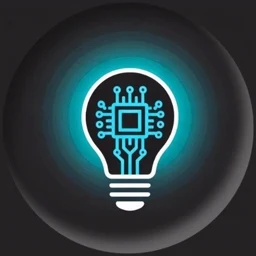

# Brajendra (BKC) Portfolio

**The whole website is an iPhone.** Lock screen, home screen widgets, Focus settings, folders, reels, notifications and iMessage, in Liquid Glass.


</div>

<p align="center">
  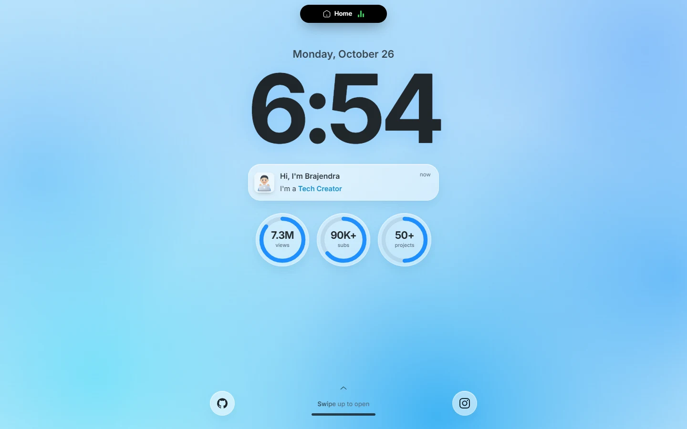
  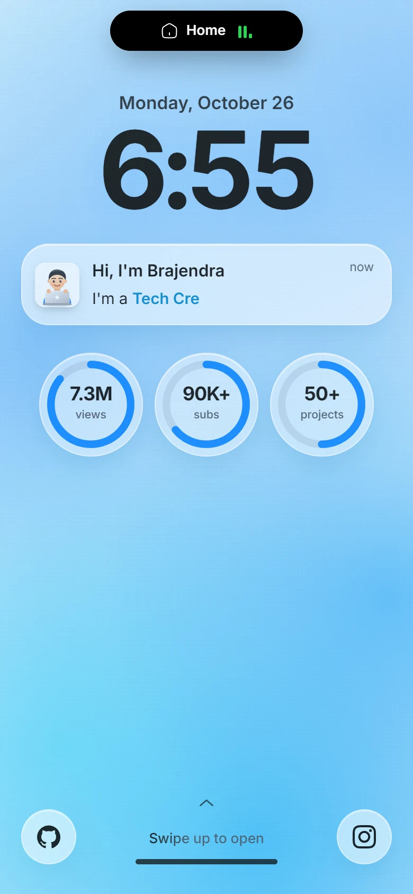
</p>

## About

Portfolio of **Brajendra**, 19+, a developer, YouTuber and tech creator from Madhya Pradesh, India. He builds apps and teaches tech on the **You B Tech** channel (7.3M+ views).

## Languages and tools

**Languages**

<p>
  
</p>

| | Language | Used for |
| --- | --- | --- |
|  | Dart | Flutter apps |
|  | Kotlin | Android native |
|  | Java | Android native |
|  | Python | Automation and AI agents |
|  | JavaScript | Web apps and this site |
|  | HTML | Web pages and chatbots |
|  | CSS | Layout and animation |

**Frameworks and tools**

<p>
  
</p>

**Skill levels**

| Skill | Level |
| --- | --- |
| Tech tutorials | 95% |
| AI and prompt engineering | 85% |
| Backend development | 71% |
| Android native | 57% |
| Frontend development | 45% |
| Python development | 23% |
| Flutter development | 21% |

## Screenshots

### Desktop

| Home screen | Focus |
| --- | --- |
| 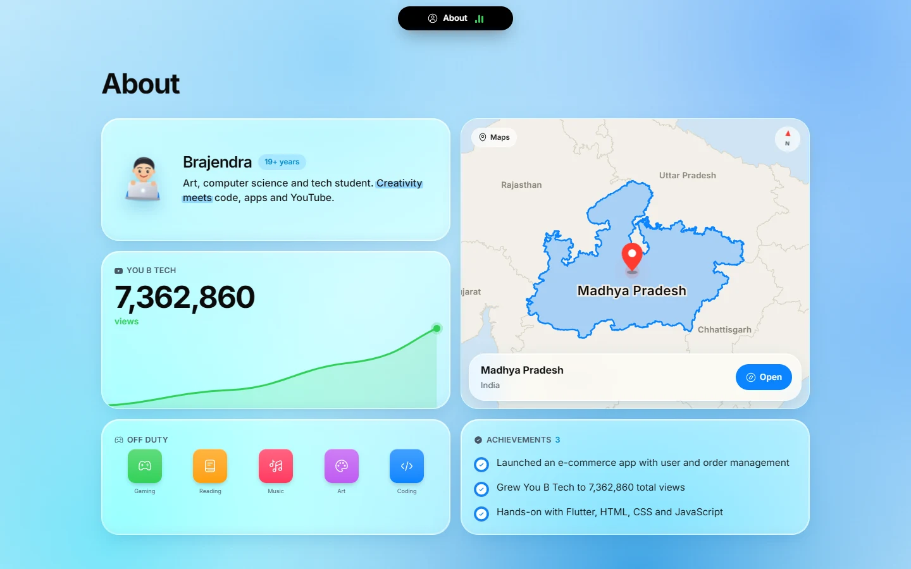 | 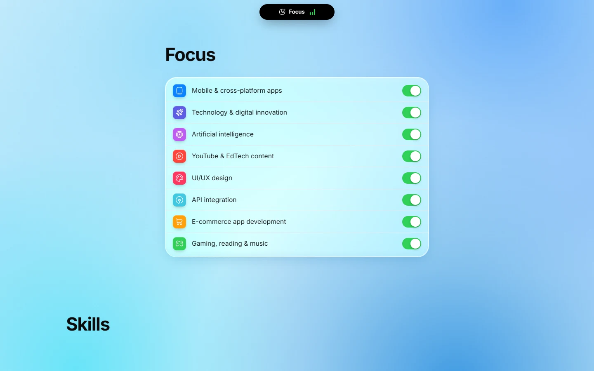 |

| Skills | Projects |
| --- | --- |
| 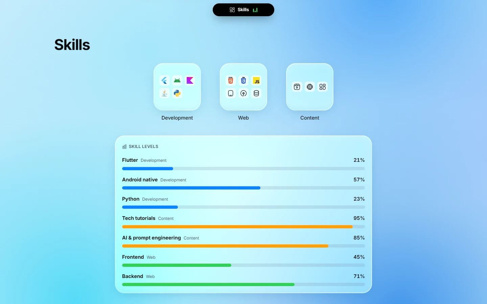 | 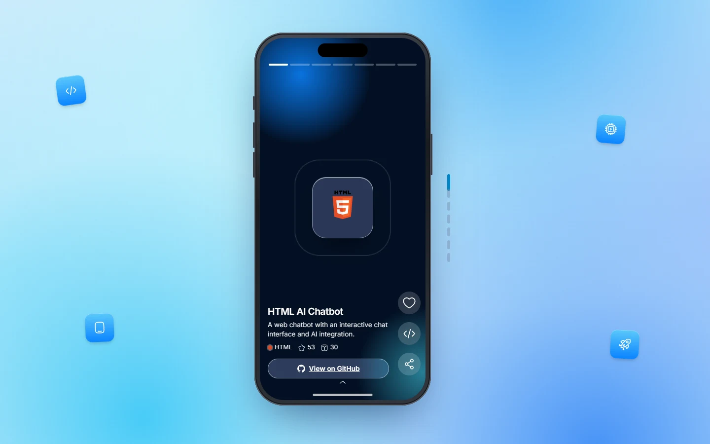 |

| Channel | Social |
| --- | --- |
| 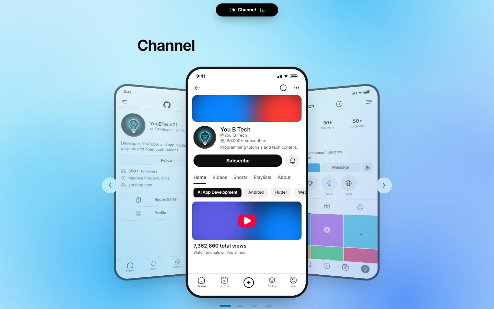 | 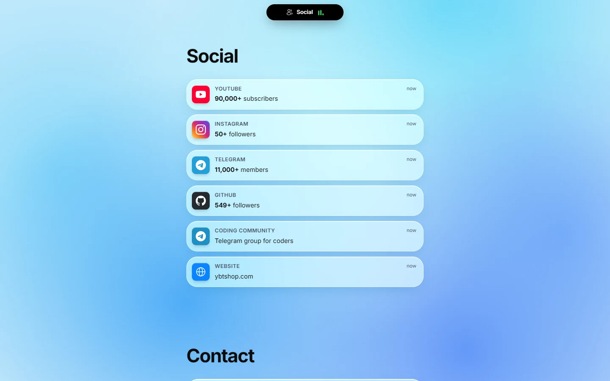 |

| Contact | Dark mode |
| --- | --- |
| 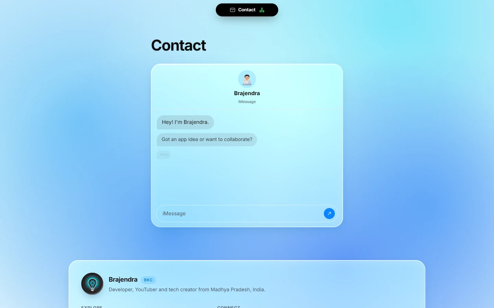 | 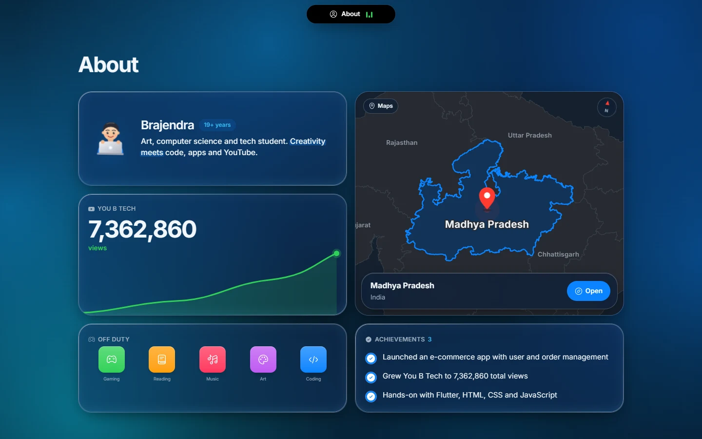 |

### Mobile

<p align="center">
  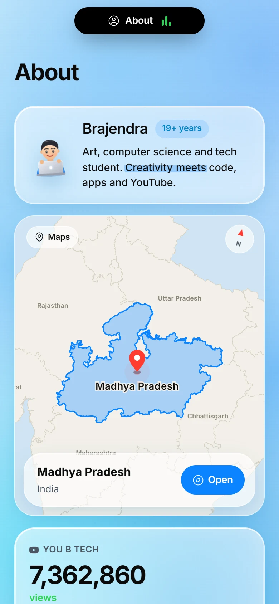
  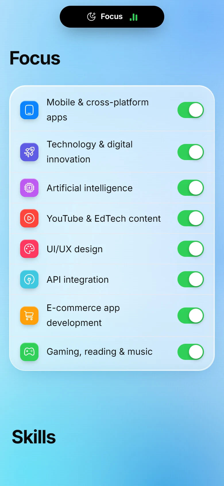
  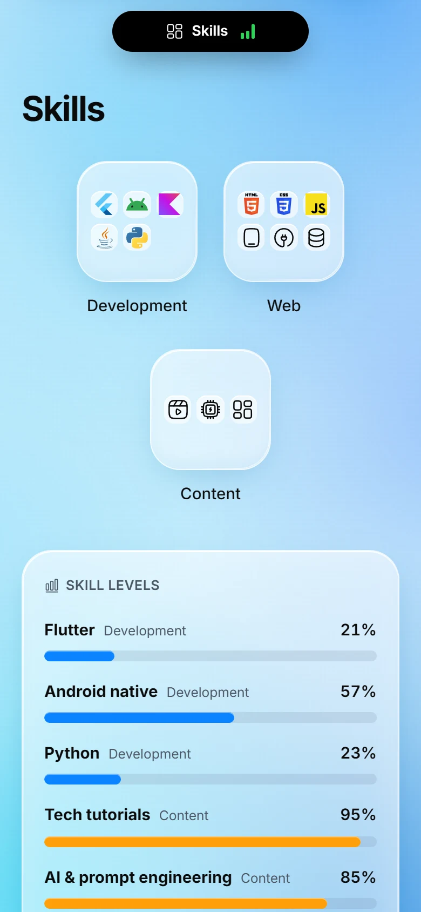
  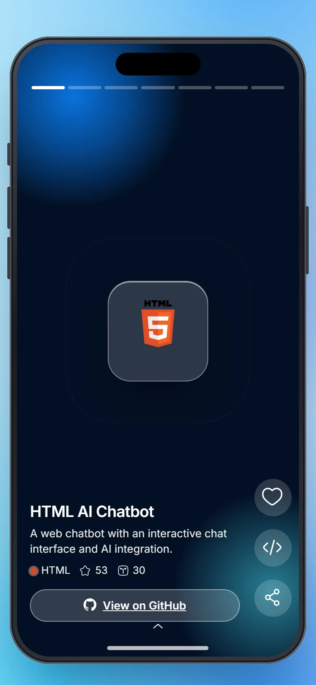
</p>
<p align="center">
  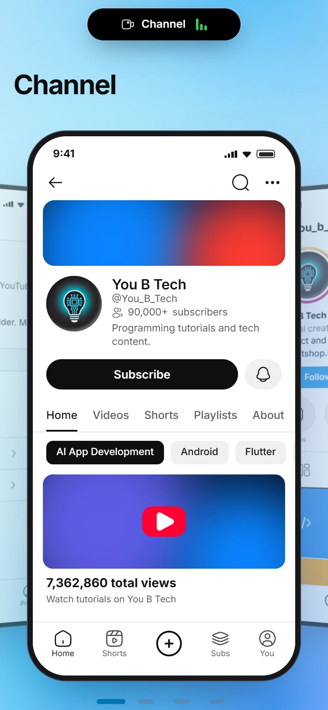
  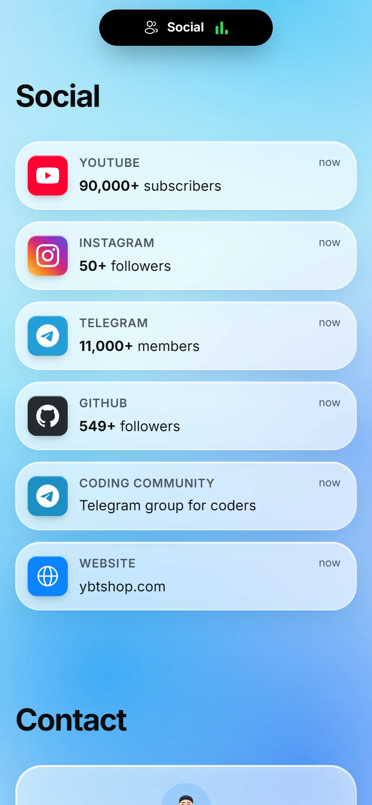
  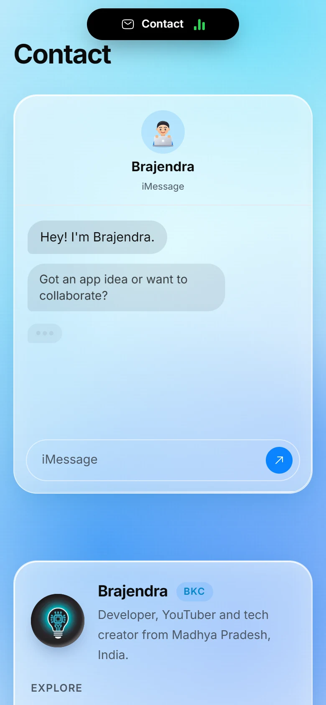
</p>

## Features

- **Lock screen hero** with a live clock, a notification and swipe up to unlock.
- **Home screen widgets**: profile card, YouTube views graph, a real Madhya Pradesh map, achievements and hobbies.
- **iOS bottom sheets** for skill folders, and a Focus settings list.
- **Project reels inside a phone**: 6 top GitHub repos plus a "50+ projects" YouTube slide.
- **Channel deck**: swipe through YouTube, Instagram, Telegram and GitHub app screens.
- **Social notifications** that arrive one at a time, and an iMessage style contact thread.
- **Liquid Glass** material, light and dark mode, and a moving sky-blue background.
- **Sound effects** on interactions with one voice at a time, so sounds never overlap.
- **Boot screen** that preloads sounds, fonts and images so scrolling stays smooth afterwards.
- **Responsive** for phones and desktops, and opens full screen on mobile after the first tap.

## Views and likes (mini JSON database)

The footer shows **website views** and a **like** button (tap again to remove your like). The numbers are one small JSON document, `{ "views": 0, "likes": 0 }`:

- **Live on Netlify:** `netlify/functions/stats.mjs` keeps it in Netlify Blobs at `/api/stats`. Writes use the document's etag, so visitors at the same moment never overwrite each other.
- **Local (`npm run dev` / `npm run preview`):** the same API is served by `server/vite-stats.js` and stored in `data/stats.json`.
- One view is counted per browser session, and one like per visitor (kept in `localStorage`).

## Tech stack

| | |
| --- | --- |
|  | React 19 |
|  | Vite |
|  | Plain CSS (no Tailwind) |
| | `motion` for animation, `lenis` for smooth scroll, Iconify for icons, Web Audio for sound |

## Run locally

```bash
npm install
npm run dev
```

## Build and deploy

```bash
npm run build     # outputs to dist/
npm run preview   # serve the production build locally
```

`dist/` is a static site, so it works on Netlify, Vercel, Cloudflare Pages or GitHub Pages. A `netlify.toml` is included.

## Links

[](https://youtube.com/@You_B_Tech)
[](https://github.com/YouBTech01)
[](https://www.instagram.com/you_b_tech)
[](https://t.me/YouBTech)
[](https://ybtshop.com)
